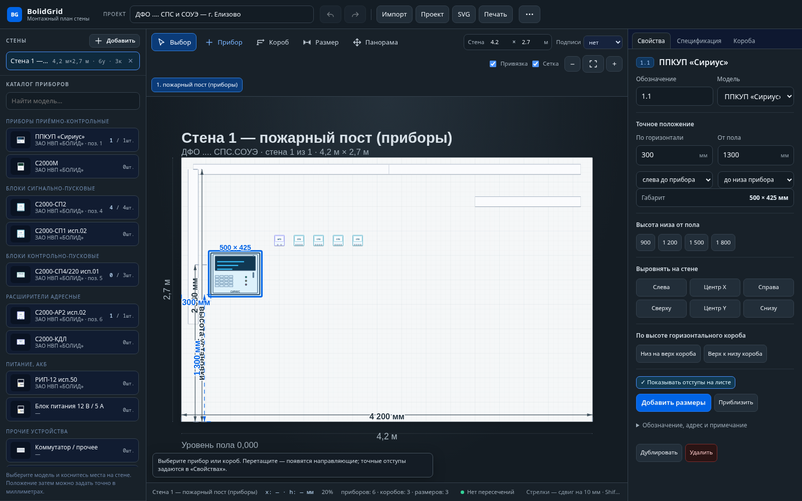
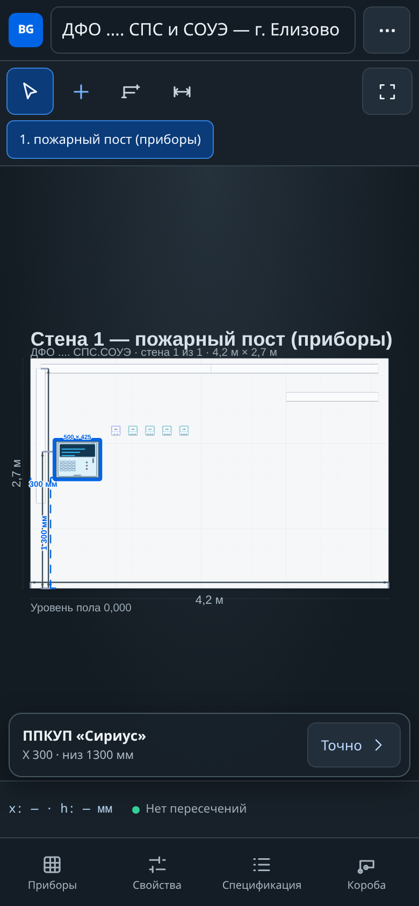

# BolidGrid

**Монтажный план стены для согласования приборов и коробов DKC.**

Работает прямо в браузере — на компьютере и телефоне, без установки и регистрации.

<p align="center">
  <a href="https://enkolesnikov.github.io/BolidGrid/"><strong>Открыть BolidGrid</strong></a>
  ·
  <a href="docs/USAGE.md">Руководство</a>
  ·
  <a href="docs/QA-REPORT.md">Проверки качества</a>
</p>

<p align="center">
  <a href="https://enkolesnikov.github.io/BolidGrid/"></a>
  <a href="LICENSE"></a>
  
</p>



## Основной сценарий

1. Задайте длину и высоту стены.
2. Разместите приборы с реальными габаритами.
3. Проведите горизонтальные и вертикальные трассы коробов.
4. Задайте точные координаты, выравнивание, распределение и зазоры.
5. Проверьте пересечения, добавьте размеры и выгрузите лист.

### Что умеет редактор

- **Точное положение.** X от левого края и высота от пола; точки отсчёта по краю или центру прибора.
- **Удобная геометрия.** Сетка, умные привязки, выравнивание, равномерное распределение и точный свободный зазор.
- **Пластиковые кабель-каналы DKC.** Гладкая ПВХ-крышка, тонкие кромки и стыки секций, ортогональные сегменты, ширина, тип и цвет, редактирование участков и вершин.
- **Контроль размещения.** Автоматическая проверка пересечений «прибор ↔ прибор» и «прибор ↔ короб» с переходом к проблемному месту.
- **Размеры.** Временные отступы при выборе и постоянные горизонтальные/вертикальные размерные линии.
- **Рабочие документы.** Спецификация, ведомость коробов, JSON, SVG, печать/PDF, CSV и Markdown.
- **Несколько стен.** Переключение, переименование, копирование проекта через JSON и история undo/redo.
- **Телефон.** Нижние шторки, крупные элементы управления, выбор точных координат, панорама и pinch-zoom.

<p align="center">
  
</p>

## Быстрый запуск локально

Нужен **Node.js 20 или новее**.

```bash
npm install
npm start
```

Откройте `http://localhost:8080`. Production-сборка не требуется: приложение состоит из HTML, CSS, SVG и нативных JavaScript-модулей.

## Проверки

```bash
npx playwright install chromium
npm run test:all
```

Три набора проверяют редактор, основной сценарий согласования и сенсорную работу на трёх мобильных размерах. Подробности и актуальные результаты — в [отчёте QA](docs/QA-REPORT.md).

## Документация

- [Руководство пользователя](docs/USAGE.md)
- [Формат проекта и система координат](docs/DATA-MODEL.md)
- [Отчёт о браузерных проверках](docs/QA-REPORT.md)
- [Инструкция для ИИ-сессий и разработчиков](AGENTS.md)

## Хранение и ограничения

Проект автоматически сохраняется **только в текущем браузере**. Синхронизации между устройствами нет; для переноса и резервной копии используйте JSON. BolidGrid помогает согласовать компоновку, но не заменяет инженерную проверку и нормативный расчёт.

## Лицензия

[MIT](LICENSE). Исходные позиции спецификации и модели приборов относятся к рабочему проекту; перед использованием в новом объекте проверьте актуальность габаритов и наименований оборудования.
