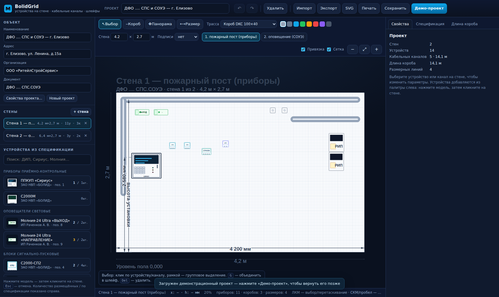
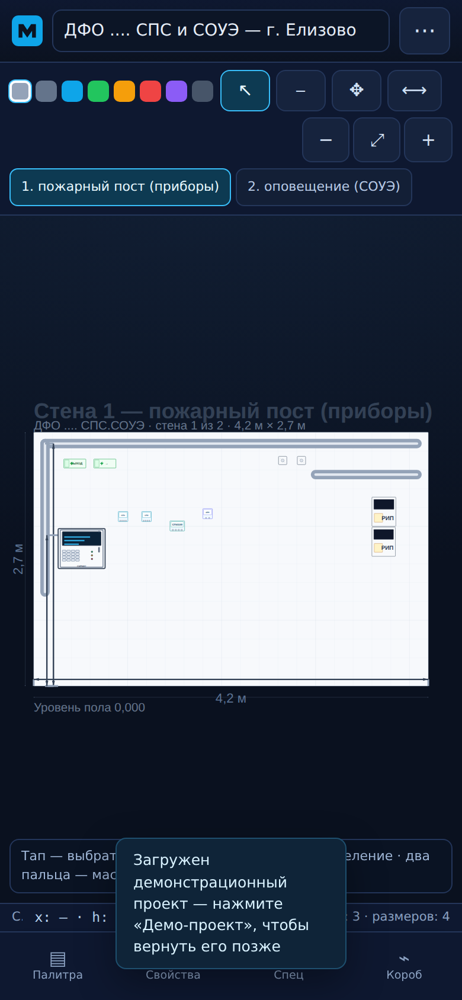

# BolidGrid

**Веб-приложение для монтажного плана на стене:** приборы БОЛИД и другие — в реальном
масштабе, короба (DKC 100×40 и др.) с изменяемым цветом и подсчётом «сколько нужно метров»,
размерные линии со стрелками, спецификация. Без шлейфов и лишних подписей.

**Живая версия:** https://enkolesnikov.github.io/BolidGrid/ · **Репозиторий:** https://github.com/enkolesnikov/BolidGrid



<p align="center"></p>

Проект создан по рабочей документации **«ДФО .... СПС.СОУЭ — г. Елизово, ул. Ленина, д.15а»**
(система пожарной сигнализации и СОУЭ): 30 позиций спецификации, оборудование ЗАО НВП «БОЛИД»,
ИП Раченков А. В., ООО «Промрукав» и др. Источник и методика извлечения данных — [docs/SPEC-SOURCE.md](docs/SPEC-SOURCE.md).

---

## Возможности

**Стена как монтажная плоскость**
- Несколько стен (фронтальных проекций) с длиной и высотой в метрах; переключение вкладками.
- Миллиметровая сетка, привязка, панорама и масштаб, реальные габариты устройств.

**Устройства из спецификации**
- Приборы и оповещатели из спецификации проекта (ППКУП «Сириус», С2000-СП2, С2000-СП4/220,
  С2000-АР2, «Молния-24 Ultra», КМ-О(2К)) **и** дополнительные устройства
  БОЛИД (С2000-КДЛ, С2000-СП1, С2000М, РИП-12, блок питания) и «прочее».
  АКБ, МПН и Маяк-24-3М убраны из палитры (в спецификации остаются, в старых проектах
  продолжают отображаться — их можно удалить).
- **Габариты приборов — по ТД производителя**, лист в миллиметрах: приборы и короба рисуются в масштабе.
  Например, ППКУП «Сириус» — 500×425 мм, С2000-СП2 — 102×107 мм, С2000-СП4/220 — 156×107 мм,
  РИП-12 исп.50 — 255×310 мм, АКБ Delta HRL 12-18 — 181×167 мм.
- Извещатели (ДИП-34А) и ручные ИПР в палитре скрыты — для монтажного плана стены нужны приборы,
  короба и размеры. Они остаются в спецификации (позиции 2–3) и в старых проектах.
- Счётчик «размещено / по спецификации» в палитре, размещение кликом (можно ставить несколько подряд,
  `Esc` — закончить), поворот, мультивыделение, дублирование.

**Размеры стены и комфорт работы**
- Длина и высота активной стены задаются прямо в панели инструментов (и в мобильном меню) — «Стена 4,2 × 2,7 м».
- После рисования короба он сразу выделен: на телефоне автоматически открываются «Свойства» с выбором цвета.

**Подписи на листе**
- Три режима: **нет** (по умолчанию — чистый лист), **кратко** (обозначение), **полные**
  (обозначение + адрес). Переключатель — в панели инструментов и в мобильном меню.
- При мелком масштабе подписи автоматически скрываются (LOD), чтобы не засорять лист.

**Короба**
- Пресеты коробов **DKC 100×40 (ширина 100 мм)**, DKC 60×40, DKC 40×25, лоток 100, гофра Ø20,
  труба Ø25 — трасса рисуется в масштабе реальной ширины короба.
- Ломаная только из **горизонтальных и вертикальных** сегментов — короб всегда прямой;
  при перетаскивании вершин и при импорте старых проектов диагонали не появляются.
- **Цвет короба**: палитра быстрых цветов в панели инструментов (для новых трасс и выделенного короба)
  плюс любой свой цвет в «Свойствах».
- Длина каждой трассы и итог «сколько короба нужно» — на вкладке «Длина короба», экспорт CSV.
- Без подписей на линиях и без точек подключения — чистый монтажный план.

**Размерные линии (линейки)**
- Инструмент «Размер»: две точки → линия со стрелками и подписью длины по центру
  (например «4 200 мм»). Размер остаётся в проекте, концы тянутся за маркеры,
  текст можно переопределить, отступ линии и координаты — в свойствах.
- Размеры выгружаются в SVG вместе с чертежом.

**Документация**
- **Спецификация**: сопоставление «по спецификации / фактически размещено / расхождение»,
  кабельная продукция — сопоставление расчётных длин с проектом, экспорт CSV и Markdown.
- **Длина короба**: по каждой трассе и итог по проекту (сколько короба закупать), экспорт CSV.
- Печать листа и экспорт SVG (векторный чертёж стены со всеми устройствами и трассами).

**Проект**
- Автосохранение в браузере, экспорт/импорт JSON, undo/redo (100 шагов), демонстрационный проект.

**Мобильная версия (телефон/планшет)**
- Одна колонка: шапка → компактная панель инструментов (иконки) → лист стены → нижний таб-бар.
- Панели открываются нижними шторками: «Палитра», «Свойства», «Спец», «Короб»; действия — в меню «⋯».
- Сенсорное управление: тап — выбор, удержание — добавить в выделение, два пальца — масштаб и панорама,
  перетаскивание пальцем — перенос устройства, кнопка «Готово» — завершить трассу канала.
- Крупные тач-цели (≥40 px), поля ввода 16 px (iOS не масштабирует), учтены safe-area и `100dvh`.

---

## Быстрый старт

Нужен только Node.js ≥ 18 (ES-модули и `fetch` нельзя открыть через `file://`):

```bash
node server.mjs
# BolidGrid: http://localhost:8080
```

или

```bash
npm run dev        # то же самое
```

Откройте <http://localhost:8080>. При первом запуске загружается демонстрационный проект
по спецификации — две стены, приборы, короба DKC и размерные линии.

### Публикация на GitHub Pages

В репозитории есть workflow `.github/workflows/pages.yml`: при пуше в `main` сайт
публикуется на GitHub Pages. В настройках репозитория выберите
**Settings → Pages → Source: GitHub Actions**. Приложение полностью статическое,
сборка не требуется.

---

## Как пользоваться

1. **Палитра** (слева) → нажмите нужную модель → кликните на стене. `Esc` — отмена.
2. **Короб**: инструмент «Короб» (`C`) → клики по трассе → `Enter` — готово.
   Цвет выбирается цветными квадратиками в панели инструментов или в «Свойствах»;
   тип («Короб DKC 100×40», ширина 100 мм) — в свойствах. Итог «сколько нужно метров» —
   на вкладке «Длина короба».
3. **Размеры**: инструмент «Размер» (`M`) → две точки → линия со стрелками и длиной по центру.
4. **Спецификация** — на правой вкладке, с экспортом CSV/Markdown.
5. **Печать/экспорт**: кнопка «Печать» (лист без интерфейса) или экспорт SVG
   (`Ctrl`+`S` — сохранение проекта в браузере, JSON — кнопкой «Экспорт»).

Подробный сценарий — в [docs/USAGE.md](docs/USAGE.md).

### Горячие клавиши

| Клавиши | Действие |
|---|---|
| `V` / `C` / `H` / `M` | выбор / кабельный канал / панорама / измерение |
| `Ctrl`+`Z`, `Ctrl`+`Y` | отменить / повторить |
| `Del`, `Backspace` | удалить выделенное |
| `R` | повернуть устройства на 90° |
| `Ctrl`+`D` | дублировать устройства |
| `F` или `0` | показать всю стену |
| `+` / `−`, колесо | масштаб |
| `Enter` | завершить рисование канала |
| `Esc` | отменить инструмент / снять выделение |
| `Ctrl`+`S` | сохранить проект в браузере |
| Пробел + ЛКМ, СКМ | панорама |

---

## Структура проекта

```
index.html            разметка интерфейса
css/app.css           оформление (тёмный UI + светлый лист стены, стили печати)
js/catalog.js         библиотека устройств: модели, позиции спецификации, SVG-символы
js/store.js           состояние проекта, undo/redo, автосохранение, вычисления
js/wall.js            SVG-редактор стены: отрисовка, инструменты, короба, размеры
js/panels.js          палитра, свойства, спецификация, ведомость короба
js/demo.js            демонстрационный проект по спецификации
js/util.js            геометрия, форматирование, CSV
js/main.js            сборка приложения, горячие клавиши, импорт/экспорт
data/spec.json        спецификация из рабочей документации (30 позиций, 8 помещений)
tools/pdf_decode.py   декодер текста PDF с повреждённым ToUnicode (по именам глифов)
data/*.json           (опционально) проекты для импорта
docs/SPEC-SOURCE.md   как извлечена спецификация из PDF, что уточнить
docs/USAGE.md         руководство пользователя
docs/DATA-MODEL.md    формат файла проекта
server.mjs            статический сервер без зависимостей
tests/smoke.mjs       смоук-тест интерфейса (Playwright, 44 проверки)
tests/qa.mjs          расширенный QA-сьют (Playwright, 178 проверок)
tests/mobile.mjs      мобильные проверки 390×844 / 360×780 / 412×915 (Playwright, 96 проверок)
docs/QA-REPORT.md     отчёт независимого QA, найденные и исправленные дефекты
```

Данные проекта хранятся в `localStorage` (`bolidgrid:project:v1`) и могут быть
выгружены в JSON — формат описан в [docs/DATA-MODEL.md](docs/DATA-MODEL.md).

---

## Технологии

- Ванильный JavaScript (ES-модули), SVG-рендеринг без фреймворков и сборки.
- `data/spec.json` — спецификация, извлечённая из PDF рабочей документации
  (PDF с повреждённым ToUnicode: текст восстановлен по именам глифов встроенного шрифта).
- Playwright — смоук-тест (`npm test`), QA-сьют (`npm run test:qa`) и мобильные проверки (`npm run test:mobile`).

## Ограничения

- Габариты устройств и координаты — проектные допущения; уточняйте по ТД производителя.
- Длина короба — по геометрии трасс, без запаса на разделку и монтажных припусков:
  коэффициенты запаса задаются при согласовании.
- Приложение не заменяет проектную документацию и не выполняет нормативные расчёты
  (СП 484.1311500.2020, СП 485.1311500.2020 и др.).

## Лицензия

MIT — см. [LICENSE](LICENSE).
